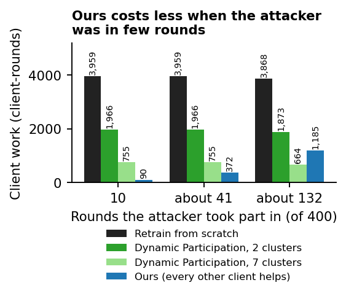
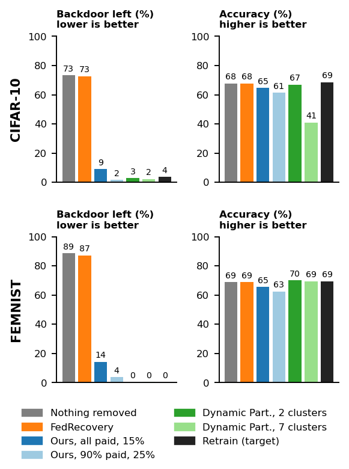

# Federated unlearning when the server only kept the sums

How much extra work do clients have to do to remove one client, for example a backdoor attacker, from a
federated model when **secure aggregation** means the server only ever kept the *sum* of each round's updates?

This is the code for our course project. The final report is [`report.pdf`](report.pdf): *Federated Unlearning Without Per-Client History: How Much Client Work Does Removal Actually Need?*
Team: Singamsetti Komal Sandeep, Uddisa Kkaartthiek, Shaurya Varshney, Sankul Rahate. Guide: Haroon Lone (IISER Bhopal).

## Summary

- **Problem.** In federated learning, many clients train one model. With secure aggregation the server sees
  only the total of their updates in each round, so the usual unlearning methods, which subtract a client's
  *saved* updates, cannot be used: the server does not have them. All it keeps is the starting model, who took part in each
  round, and one total per round.
- **Simple trick.** For each round the attacker joined, the *other* clients redo the round from the stored model.
  The stored total minus their total is the attacker's update. This is ordinary arithmetic on totals (the multi-round leak of
  So et al., AAAI 2023, used on purpose for one identified client). We then take back a share of the attacker's
  contribution from the final model, using the rule of Wu et al. (2022) with a damping factor.
- **Cost.** We count client work in *client-rounds* (one client redoing one past round). Redoing the attacker's rounds costs about
  **2%, 9% or 31% of retraining from scratch** for an attacker that joined 10, ~41 or ~132 of 400 rounds.
- **Quality.** Taking back about 15% of the attacker's contribution weakens the backdoor; the longer the attacker took part,
  the more clean accuracy this costs. It does not make the model match the retrained one, so we call it *approximate backdoor mitigation*.
- **Comparison.** Against our reimplementations of FedRecovery (needs per-client gradients; barely changed the backdoor here) and
  Dynamic Participation (changes training; more accurate on FEMNIST and cheaper for long attackers), ours needs no change to
  training and is cheaper for short attackers.
- **Controls.** A random or honest-client correction does nothing. But simply rolling back part of the attacker's rounds,
  with no redoing at all, lowers the backdoor almost as much; the recovered update keeps 2 to 12 points more accuracy at the
  same share (Experiment 6).

<p align="center">
  
  
</p>

## How it works

The server keeps `H = { theta_0, S_t, a_t }`: the starting model, who took part in round `t`, and the sum of that round's updates.
To remove a client `k` (here, a backdoor attacker):

1. **Recover its update.** The other clients of a round redo it from the stored model, and the server subtracts their sum
   from the stored one: `g_k = a_t - sum_{i != k} g_i`. This is exact, because a redo reproduces the original (same model,
   data, batch order and seeds).
2. **Take back a share of it.** The correction for round `t` is `(a_t/m - g_k) / (m-1)`, and the unlearned model is
   `theta_T + lambda * sum_t correction_t`. `lambda = 1` is the rule of Wu et al. (2022); the damping `lambda`
   (about 0.15 works) is our addition, because taking back everything lowers accuracy a lot.

## Repository

```
secunlearn/    the solution: data, training with a stored history, recovery, unlearning, baselines
main/          scripts that reproduce the experiments of the final report (Experiments 1-6) and its figures
ablation/      extra experiments and checks, not needed to reproduce the report
results/       csv tables of our runs (results/main, results/ablation)
report.pdf     the final report
figures/       the report's figures (cost, quality, share) and a cost-quality plot
tests/         fast checks on synthetic data (no download, no GPU)
```

Core functions: `train_federation` and `History` (`secunlearn/training.py`), `recover` and `redo_round`
(recover a client's update), `unlearn(history, updates, lam)` (`secunlearn/unlearning.py`), `quantise` (`secunlearn/model.py`).

## Quick start

```bash
pip install -r requirements.txt
python -m pytest tests          # a few seconds, no data needed

# a tiny run on random data to check that everything works (no download, a minute or two)
python main/exp1_share_to_subtract.py --smoke --dataset synthetic --tags f0
```

## Reproducing the report (`main/`)

Setting unless stated: CIFAR-10, 100 clients, 10 per round, 400 rounds, 3 seeds. Client 0 is the attacker; three attackers
(tags): `j10` joins 10 rounds then leaves, `f0` is picked like any client (about 41 rounds), `f4` is also put into every
fourth round (about 132). Tags `boost`, `a01`, `a100` are used in Experiment 5. Training runs are shared: each (tag, seed) is trained once.

| Report | Script | What it does | Tables |
|---|---|---|---|
| Exp 1: what removal costs, how much to take back | `main/exp1_share_to_subtract.py --tags j10 f0 f4` | recover exactly, take back a share `lambda` from a grid | `results/main/exp1_share/` |
| Exp 2: which clients to pay | `main/exp2_client_budget.py` | pay only some clients; 2 orders x 4 rules for incomplete rounds | `results/main/exp2_budget/` |
| Exp 3: two published methods | `main/exp3_baselines.py` (FedRecovery) and `main/exp3_clusters.py` (Dynamic Participation, clusters of its own paper) | our reimplementations, same attackers | `results/main/exp3_baselines/`, `exp3_clusters/` |
| Exp 4: FEMNIST | `main/exp4_femnist.py` | experiments 1-3 on FEMNIST (one client per writer) | `results/main/exp4_femnist/` (+ `lambda_femnist_*` in `exp1_share/`, `clusters_femnist_*` in `exp3_clusters/`) |
| Exp 5: choosing the share | `main/exp1_share_to_subtract.py` (all 6 tags + FEMNIST), then `main/analyze_share_rule.py` | `rho` and the rule `lambda = min(1, kappa/rho)`, tested leave-one-setting-out | `results/main/exp1_share/` |
| Exp 6: controls | `main/exp6_controls.py --tags f0 f4` | rollback with no client work, random and honest-client corrections, noisy and wrong redoes, train on, repair, rollback-and-retrain cost | `results/main/exp6_controls/` |
| Figures | `main/make_figures.py`, `main/make_pareto.py` | `fig_cost`, `fig_quality`, `fig_share`, `fig_pareto` | `figures/` |

```bash
# the real thing (CIFAR-10 is downloaded to ./data on first use; FEMNIST needs `datasets`)
python main/exp1_share_to_subtract.py --tags j10 f0 f4
python main/exp2_client_budget.py
python main/exp3_baselines.py
python main/exp3_clusters.py
python main/exp4_femnist.py
python main/exp6_controls.py --tags f0 f4
python main/make_figures.py
python main/make_pareto.py
```

Every script takes `--seeds`, `--rounds`, `--clients`, `--per-round`, `--per-client`, `--smoke` and `--fresh`. A finished
training run or table is skipped when you run again, so an interrupted job costs one run, not all of them. Set `SECUNLEARN_DATA`
to keep the datasets elsewhere. Model histories go to `runs/` (gigabytes; a seed rebuilds them; not in git). Tables go to `results/`.

**Time.** On a Colab T4 one (tag, seed) job of experiments 1-4 took 5 to 20 minutes. On a CPU expect many hours for the whole set;
the CPU path is deterministic but slow.

**Reproducibility.** A redone round must reproduce the original to the last bit, so training runs on CUDA or CPU with one CPU thread
and deterministic cuDNN. Apple's MPS is never used. If `verify_replay` fails on your machine, use a CPU runtime. Updates are rounded
onto an integer grid (`2**-24`) before they are added, because floating-point addition is not associative and the subtraction would
otherwise return the update plus noise; integers are also closer to real secure aggregation.

## Extra experiments (`ablation/`)

| Script | Question | Tables |
|---|---|---|
| `ablation/replay_check.py` | the gate: does a redone round reproduce the original exactly? | none (raises on failure) |
| `ablation/round_selection.py` | redo only some rounds (5 selectors x 6 budgets) and guess the rest (4 rules) | `round_selection_r400/`, `_r1000/` |
| `ablation/control.py` | how far apart are two *correct* retrained models? (a floor for distance-based scoring) | `control_r400/`, `_r1000/` |
| `ablation/diagnosis.py` | why does taking back everything lower accuracy? damping and latest-rounds-only | `diagnosis_r400/`, `_r1000/` |
| `ablation/scaling.py` | does the same *fraction* of rounds work at other sizes N and m? | `scaling_r400/`, `_r1000/` |
| `ablation/which_clients.py` | which helpers to ask, one at a time (`--drop`: leave one helper out) | `which_clients_r400/`, `_r1000/` |
| `ablation/poison_damping.py` | the mid-term backdoor experiment (20 clients, 200 rounds) | `poison_damping/`, `poison_damping_n100/` |
| `ablation/dp_fixed_groups.py` | Dynamic Participation with groups of 10/20/50 (before we used its own clustering) | `dp_fixed_groups/` (not run yet) |

`_r400` / `_r1000` is the number of rounds (the removed client then joins about 40 / 100 rounds). The ablations that remove a harmless
client use clients 0, 1, 2 as the removed ones.

## Notes and limits

* Secure aggregation is **simulated**: we add integer updates and do not run the masking protocol. The attacker's true updates are
  kept in a separate `oracle` file **for marking only**; the method never reads them.
* Recovering one client's update by differencing is the multi-round leak described by So et al. (AAAI 2023). We use it on purpose,
  for one identified attacker only.
* FedRecovery and Dynamic Participation are **our reimplementations** (neither paper links code). Where the papers are silent the
  settings are ours; see `secunlearn/baselines.py` and `main/exp3_clusters.py`.
* The shares of Experiments 1-4 were chosen with the retrained model at hand; the fixed 15% of Experiment 5 was chosen on the same
  eight settings.
* Experiment 6 was run on a Colab T4, so its numbers differ slightly from Experiment 1's.
* One dataset pair, one network, one kind of attack.
